# Tutorial de uso diário — Rota Santos (app Android offline)

As capturas são do app real, rodando no navegador durante o E2E V2 com as **300 cartas fictícias** do teste
(`docs/EVIDENCIAS_E2E_V2/`).

## 0. Instalar ou atualizar (uma vez)

1. Baixe `releases/rota-santos-1.2.0-DEBUG.apk` no celular. Confira o SHA-256 em `releases/SHA256SUMS.txt`.
2. Abra o arquivo e permita "instalar apps desta fonte". A 1.2.0 atualiza por cima da 1.0/1.1 **sem apagar os
   dados** (faça um backup cifrado antes, por precaução).
3. Para a versão release assinada com a sua chave, veja `mobile/SIGNING.md`. Trocar debug → release exige
   backup, desinstalar e restaurar.

## 1. Primeiro uso: confirmar o ponto de partida

**Ajustes → Ponto de partida → Localizar endereço.** Arraste o pino até a porta da Rua Joaquim Távora, 480 e
toque em **Confirmar o pino como ponto de partida**.

O app **não calcula rota** enquanto a partida não estiver confirmada. O endereço buscado no mapa costuma cair
no meio da rua, não na porta.

## 2. Todo dia: importar as cartas

**Painel → IMPORTAR E PLANEJAR.**
1. Escolha o CSV ou XLSX, ou cole as linhas. O separador é detectado sozinho.
2. Toque em **Pré-visualizar** e confira:
   - **Linhas** = número de cartas do dia;
   - **Imóveis únicos** = número de paradas;
   - **Com erro** (por exemplo, sem logradouro): essas linhas não entram.

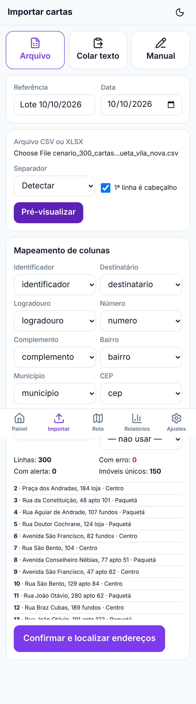

3. Toque em **Confirmar e localizar endereços**. Importar o mesmo arquivo duas vezes pede confirmação, e IDs
   repetidos não duplicam.

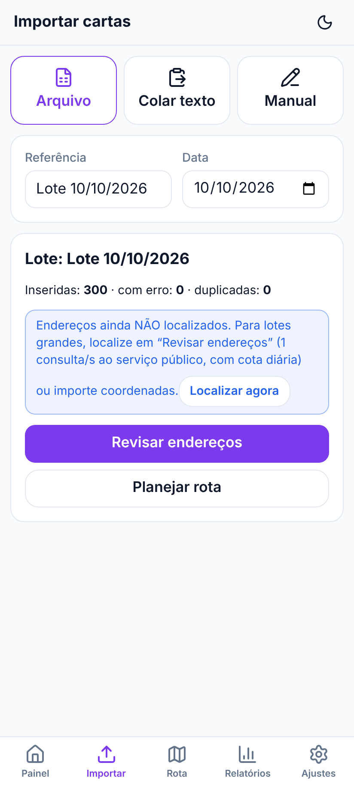

## 3. Conferir endereços

O Painel mostra **"N cartas / N imóveis / N bairros"** e o cartão **Endereços a conferir**.

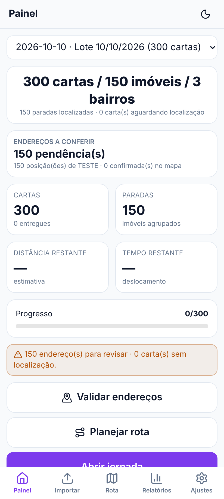

**Validar endereços → Precisam de revisão:**
- Toque num endereço e **arraste o pino roxo até a portaria do imóvel**.
  - **Confirmar portaria**: só quando o ponto é a entrada real (dá para anotar "portão azul", "interfone 12"). A rota passa a usar esse ponto.
  - **Confirmar posição**: o pino está no lugar certo do número, mas não é a portaria.
  - **Reverter última alteração** e **Invalidar confirmação** desfazem erros; confirmações com mais de 1 ano aparecem como "confirmação antiga".
  - Depois de confirmar, o app abre o próximo endereço da lista (nunca confirma sozinho). Confirmações ficam salvas para os próximos dias.
  - O selo de cada endereço mostra o nível de confiança: portaria confirmada > pino confirmado > número na fonte > interpolado (aproximado) > só a rua (não confirmado).
- **Localizar** consulta o provedor de endereços **só dos endereços únicos ainda sem posição**, em fila que dá para cancelar e retomar. O Nominatim público atende no máximo 30 por vez e tem cota diária (Ajustes, 250 por padrão); para volume use uma instância própria (Ajustes → Geocodificação em lote). Endereços
  "só a rua" entram na rota **marcados como aproximados**. Em Ajustes dá para exigir confirmação antes de rotear.

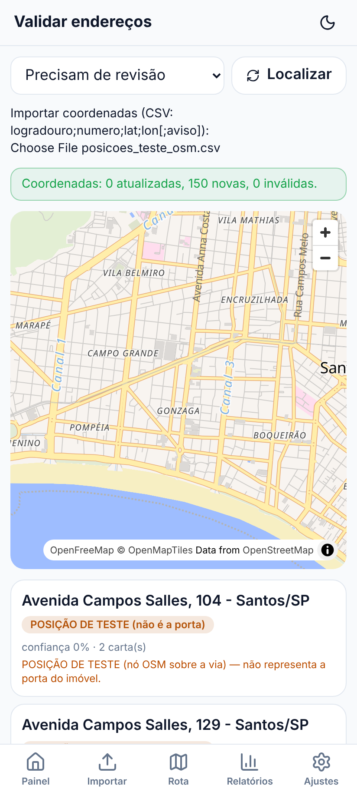

## 4. Planejar a rota

**Painel → Planejar rota.**
1. Escolha **Aberta** (padrão: termina na última entrega), **Circular** (volta à base) ou **Destino fixo**.
2. Ajuste a velocidade pedalando e a pé, a política para escadas e o tempo de cálculo.
3. Toque em **Calcular rota**. Dá para **Cancelar** no meio sem estragar nada.

O app compara várias soluções e mostra a escolhida. Se alguma parada não tem caminho pela malha de pedestres,
aparece **ROTA PARCIAL** com o motivo; nunca é declarado sucesso.

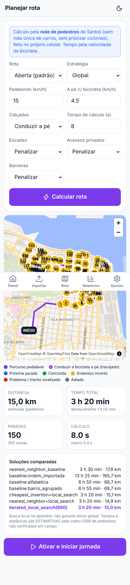
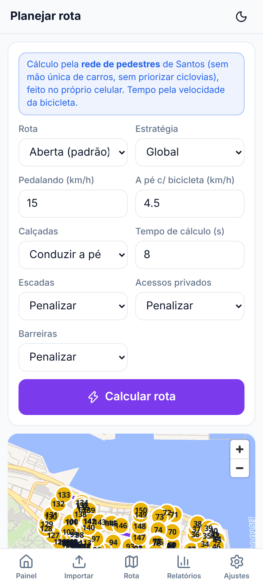

## 5. Na rua: a jornada

**Painel → Abrir jornada.** O topo mostra a **próxima parada** (rua e número grandes) e quantas cartas há
nela.

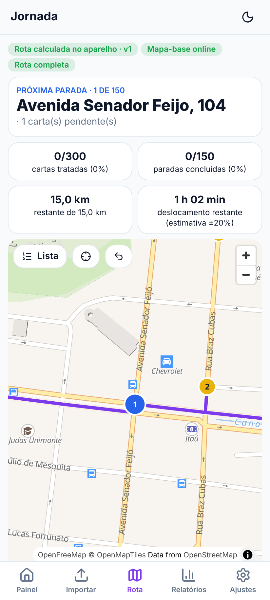

**Em cada carta:**
- toque em **Entregue**, **Não entregue**, **Adiar** ou **Endereço errado**;
- num prédio com várias cartas, cada uma é marcada individualmente, e a parada fica **Parcial** até acabar.

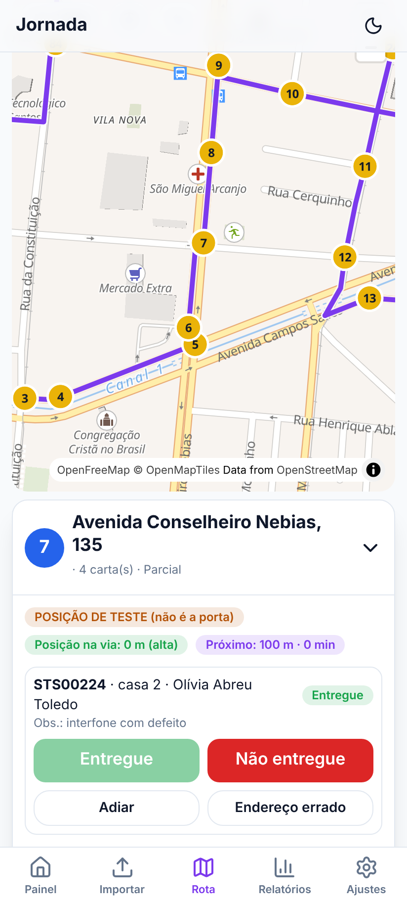

**Errou?** Use **Desfazer última ação**.

**Observação:** cada carta tem um campo "Observação (opcional)" para anotar algo em campo; ele vai no relatório e não muda o status.

**Outros controles:**
- **Fixar como próxima:** atende uma parada fora de ordem.
- **Pular endereço:** adia uma parada.
- **Próxima parada →:** avança.
- Os avisos **"Acesso cruza outra via — confira o lado"** e **"Via mais próxima não conectada"** indicam um pino
  que merece atenção.

**Replanejar no meio do dia:**
- **Recalcular a partir da última parada** visita só o que falta.
- **Recalcular da minha localização** usa o GPS. Se o GPS não responder em 15 s ou estiver fora da malha, o app
  avisa e continua sem ele.

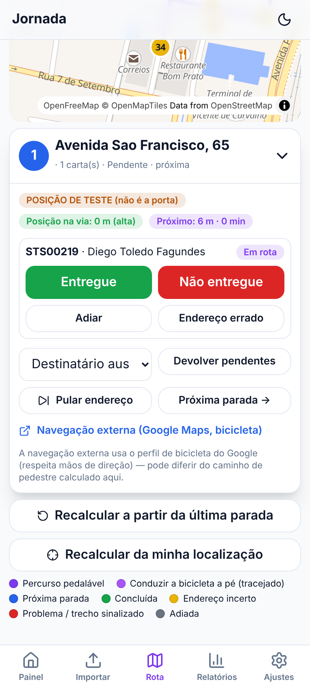

**Sem internet:**
- A rota, as marcações e o recálculo funcionam.
- O mapa mostra as **ruas de Santos com nomes** (pacote offline embutido; selo "Mapa offline (pacote de Santos)"). Fora do recorte do pacote, ou se o pacote faltar, o fundo vira liso com a rota e as paradas numeradas ("Mapa-base indisponível").
- Tudo fica gravado no celular, mesmo se o app for fechado.

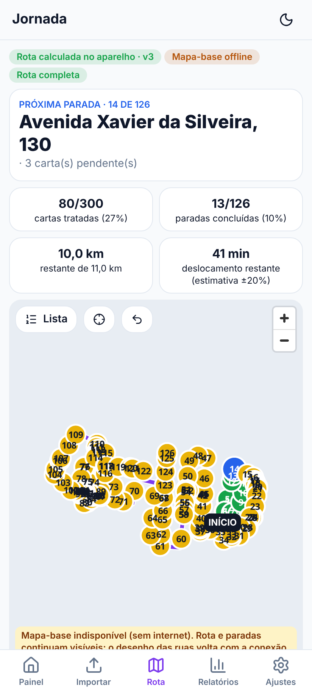

## 6. Fim do dia

**Relatórios:** veja o planejado × registrado e os motivos por bairro e status. Toque em **CSV** ou **XLSX** para
exportar. Textos que pareçam fórmulas são neutralizados na planilha.

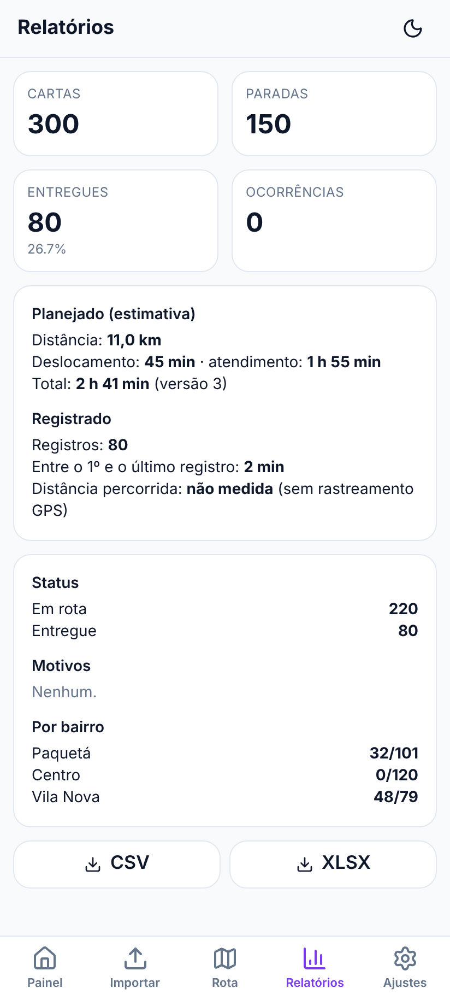

**Ajustes → Exportar diagnóstico de desempenho:** gera um arquivo só com tempos de cálculo, memória e versões (sem nomes nem endereços), útil para comparar aparelhos.

**Ajustes → Exportar backup:**
- Use **com senha**. O arquivo tem nomes e endereços e sai cifrado (AES-GCM).
- Guarde-o fora do celular, por exemplo no Drive ou no e-mail para você mesmo.
- **Restaurar backup** guarda antes um instantâneo do estado atual, que pode ser desfeito com **Desfazer última
  restauração**.
- **Verificar integridade dos dados** confere se nenhuma carta ou registro sumiu.

## Lembretes

- Os tempos são **estimativas**: 45 s por parada + 10 s por carta extra + caminhada até a porta. Ajuste em
  Ajustes depois de alguns dias de uso real.
- A rota segue só caminhos que existem no OpenStreetMap. Se uma passagem real não estiver no mapa, o app não a
  usa.
- O Nominatim público não serve para centenas de endereços por dia. Confirme os pinos uma vez e eles ficam
  salvos.
